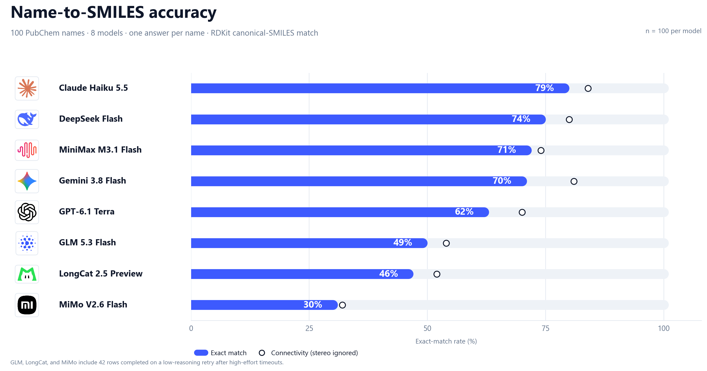

# Name2SMILES Dataset

**English** | [简体中文](README.zh-CN.md)

Most language-model benchmarks for chemistry ask whether a model can read a
SMILES string. This project tests the harder direction: given only a molecule
name, can a model write the correct structure? It builds a reproducible
benchmark from PubChem, with reference structures, descriptor metadata, 2D
depictions, and coordinate files, then runs candidate models through one
provider-agnostic client and scores their answers with RDKit. Version 0 is
built: 1,500 records selected for coverage of elements, ring systems,
stereochemistry, charge states, and functional groups. A first 100-record
benchmark across eight models is complete; the headline results are below.

## Benchmark results

Eight models answered the same 100 PubChem names, one call per name.
Claude Haiku 5.5 leads exact match at 79%.
GPT-6.1 Terra is the cheapest at CNY 0.07 per 100 names and CNY 0.11 per 100
exact answers. Accuracy falls from 78% on the easiest tier to 28% on the
hardest.

Reasoning was enabled and set to `high` where supported. Forty-two retry
records used `low`; see the full report for the detailed settings.



| Model | Exact | Connectivity | Valid | CNY / 100 names | CNY / 100 exact |
|---|---:|---:|---:|---:|---:|
| Claude Haiku 5.5 | 79% | 84% | 100% | 0.20 | 0.25 |
| DeepSeek Flash | 74% | 80% | 100% | 5.04 | 6.82 |
| MiniMax M3.1 Flash | 71% | 74% | 98% | 2.12 | 2.99 |
| Gemini 3.8 Flash | 70% | 81% | 94% | 4.86 | 6.94 |
| GPT-6.1 Terra | 62% | 70% | 93% | 0.07 | 0.11 |
| GLM 5.3 Flash | 49% | 54% | 91% | 2.17 | 4.42 |
| LongCat 2.5 Preview | 46% | 52% | 88% | 4.80 | 10.43 |
| MiMo V2.6 Flash | 30% | 32% | 74% | 0.94 | 3.13 |

See [the full report](docs/eval_mini_100.md) for tier breakdowns, token use,
run settings, and caveats.

**Scope:** budget limits kept the first run to 100 of the 1,500 records. The
eight systems are lightweight, Flash, or preview models from their vendors,
not flagship models. Read this as a low-cost comparison, not a ranking of each
vendor's best model.

## Features

- 1,500 unique PubChem records, one InChIKey each, 968 non-empty Murcko
  scaffolds.
- Coverage-aware sampling across element class, heavy-atom count, ring count,
  stereochemistry, charge, 53 functional groups, and structural flags.
- Six 2D depictions per record: RDKit clean PNG and SVG, RDKit without
  stereochemistry, RDKit with atom indices, RDKit low-resolution PNG, and the
  PubChem image.
- A 2D SDF, a PubChem 3D SDF when available (1,068 records), and an RDKit
  ETKDG fallback conformer (365 records).
- RDKit descriptors, element counts, ring sizes, spiro and bridgehead atoms,
  stereocenters, and Murcko scaffold for every record.
- A 100-record mini set for quick, low-cost checks, split into five
  difficulty tiers and covering every functional group in v0.
- One client for 20 models across 10 providers, handling
  OpenAI-compatible and Anthropic-compatible APIs, token accounting, and
  reasoning controls.
- A price table and cost estimator, plus pilot and resumable batch runners that
  parse SMILES and score them with RDKit.
- A resumable build pipeline with rate-limited, cached PubChem requests.

## Requirements

- Python 3.11 or newer. The dataset was built with Python 3.13.
- RDKit. Version 0 used RDKit 2025.09.1.
- About 170 MB of disk space for the full set of images and coordinate files.
- API keys only for the evaluation scripts. Building the dataset needs none.

## Installation

```powershell
python -m venv .venv
.\.venv\Scripts\Activate.ps1
python -m pip install -e ".[test]"
Copy-Item .env.example .env
```

Scripts and tests add `src/` to the path themselves, so the editable install
is a convenience rather than a requirement. Fill the keys for the models you
plan to call in `.env`. Each key is optional; a model is skipped when its key
is missing.

## Quick start

The repository includes the 100-record mini set. After installation, run the
tests offline:

```powershell
python -m pytest tests/
```

To build the full dataset from PubChem, run the following commands with an
internet connection:

```powershell
python scripts/sample_candidates.py --n 20000
python scripts/select_dataset.py --n 1500
python scripts/build_dataset.py
python scripts/coverage_report.py
python scripts/select_mini_dataset.py --n 100
```

`sample_candidates.py` draws random CIDs from PubChem and keeps structures
that pass the filters. `select_dataset.py` fills coverage bins greedily.
`build_dataset.py` fetches names, synonyms, images, and coordinate files, and
is resumable: rerun it to continue. The full dataset, images, and coordinate
files stay local; only `data/mini_100.jsonl` and `data/mini_100.csv` are tracked.
The pipeline depends on live PubChem
content, so a rebuild today can differ in details from the version 0 counts
below.

## Usage and configuration

### Record fields

Each record in `data/benchmark_v0.jsonl` contains:

- PubChem CID, IUPAC name, synonyms, isomeric SMILES, connectivity SMILES,
  InChIKey, molecular formula, charge, and heavy-atom count.
- RDKit descriptors: element counts, ring sizes, aromatic rings, spiro and
  bridgehead atoms, stereocenters, double-bond stereochemistry, functional
  groups, fragments, and Murcko scaffold.
- Paths to six 2D depictions, a 2D SDF, and up to two 3D SDF files.
- Source URL, retrieval timestamp, and the raw PubChem response.

### Dataset version 0

- 765 CHNO, 305 halogen, 287 S/P, 82 B/Si/Se/As, and 61 metal-containing
  records.
- 250 acyclic records and 968 distinct non-empty Murcko scaffolds.
- 1,068 PubChem 3D structures and 365 RDKit fallbacks; 67 records, mostly
  large or metal-containing, have no 3D file.
- All 1,500 records have the six 2D depictions.

The full coverage table is in [`docs/coverage.md`](docs/coverage.md), and the
dataset documentation is in [`docs/datasheet.md`](docs/datasheet.md). The
names are PubChem computed IUPAC names, not guaranteed preferred IUPAC names.

### Mini test set

`data/mini_100.jsonl` holds 100 records for quick model checks. The selector
scores every record with a heuristic difficulty model, seeds the easiest and
hardest records, then fills five tier quotas while covering element, size,
ring, stereo, charge, flag, and functional-group bins.

| Tier | Label | Records | Score range |
|---|---|---:|---|
| L1 | easy | 25 | 0-<12 |
| L2 | moderate | 30 | 12-<24 |
| L3 | hard | 20 | 24-<38 |
| L4 | very hard | 15 | 38-<52 |
| L5 | extreme | 10 | >=52 |

The mini set covers all 53 functional groups, all element classes, all
heavy-atom, ring, stereo, and charge bins, and 84 unique non-empty Murcko
scaffolds plus 16 acyclic records. Records keep their original IDs and asset
paths. Images and SDF files come from the local full dataset; name-to-SMILES
evaluation does not require them.

```powershell
python scripts/evaluate_name2smiles.py --data data/mini_100.jsonl --limit 100 --models "deepseek-flash,qwen3.8-flash" --workers 6 --reasoning low
```

The difficulty score is a planning heuristic, not a calibrated difficulty
measure. The tier ladder, score components, and coverage comparison are in
[`docs/mini_100.md`](docs/mini_100.md).

### LLM evaluation

The 20 candidate models are registered in
`src/name2smiles/llm/registry.py`. No vendor SDK is needed. The client
normalizes token usage and keeps reasoning text separate from the visible
answer. See [`docs/llm.md`](docs/llm.md) for the provider table and model IDs,
and [`docs/reasoning_controls.md`](docs/reasoning_controls.md) for the
thinking and effort parameters.

```powershell
python scripts/smoke_llm.py --all
python scripts/smoke_llm.py --provider deepseek
python scripts/smoke_llm.py --models "deepseek-v4-pro,glm-5.3"
```

The client defaults to a 50,000-token output cap. On extremely difficult
tasks with high reasoning effort, some vendors' models may still need more
than 50,000 tokens and have their output truncated at the cap. Adjust it with
`--max-tokens`, subject to the model API's limits. The batch and tier-probe
runners each default to 100,000 tokens. Temperature is omitted so each
provider uses its own default. The smoke test writes results to
`data/llm_smoke_<timestamp>.jsonl`.

The pilot runs 10 balanced records through the low-cost model set:

```powershell
python scripts/evaluate_name2smiles.py --pilot --workers 6 --reasoning low
```

The 90-call run cost 0.60 CNY with low effort. Results and observations are in
[`docs/eval_pilot.md`](docs/eval_pilot.md). The script writes one row per
model and record pair, plus a summary JSON file under `data/`.

### Cost estimation

Prices ship with the package in `src/name2smiles/llm/llm_pricing.json` and are documented in
[`docs/llm_pricing.md`](docs/llm_pricing.md). The table uses CNY per 1M tokens
and estimates costs using the effective unit prices recorded in the configuration.

```powershell
python scripts/estimate_costs.py --records 1500 --input-tokens 200 --output-tokens 800
python scripts/estimate_costs.py --records 1500 --input-tokens 200 --output-tokens 800 --models "deepseek-v4-pro,claude-opus-5.5"
```

The estimator is a planning tool. Replace the token assumptions with a pilot
run before committing to a large batch.

## Repository layout

```text
src/name2smiles/
  pubchem.py              # rate-limited PubChem client
  descriptors.py          # RDKit descriptors and functional groups
  difficulty.py           # heuristic difficulty score for mini sets
  names.py                # name quality rules
  render.py               # RDKit depictions and 3D embedding
  llm/                    # provider registry, chat client, pricing
scripts/
  sample_candidates.py    # random, filtered candidate pool
  select_dataset.py       # coverage-aware selection
  select_mini_dataset.py  # 100-record difficulty-graded subset
  build_dataset.py        # names, images, SDF files
  assign_common_names.py  # common and trade names
  recompute_descriptors.py
  validate_dataset.py
  coverage_report.py
  regenerate_large_images.py
  smoke_llm.py
  estimate_costs.py
  evaluate_name2smiles.py
tests/
src/name2smiles/llm/llm_pricing.json  # bundled model prices
docs/                     # coverage, datasheet, mini set, LLM notes
data/                     # tracked mini-100 set; other generated data stays local
```

## Tests

```powershell
python -m pytest tests/
```

The suite covers descriptors, naming rules, difficulty scoring, the PubChem
client, the LLM client, the pricing table, and the mini-set invariants. It
runs offline and needs no API key. The subset-membership check runs only when
the local `data/benchmark_v0.jsonl` exists; a fresh clone skips that one test.
GitHub Actions checks installation, tests, and installed pricing resources
on Python 3.11.

## Data availability

The 100-record mini set is included as [JSONL](data/mini_100.jsonl) and
[CSV](data/mini_100.csv), with names, reference structures, descriptors, and
difficulty metadata. The full 1,500-record dataset, images, coordinate files,
and raw evaluation outputs stay local. Contact the author if you need the
full dataset or the 800-row evaluation JSONL.

## License

The source code is released under the MIT License. The dataset, documentation,
and figures created by this project are released under the Creative Commons
Attribution 4.0 International License (CC BY 4.0). See [`LICENSE`](LICENSE) and
[`LICENSE-DATA`](LICENSE-DATA). CC BY 4.0 is used for the data because PubChem
asks for attribution when its data is reused.

The dataset is derived from PubChem. PubChem asks users to cite it when a
significant portion is reused. If you use this dataset, cite:

> Kim S, Chen J, Cheng T, Gindulyte A, He J, He S, Li Q, Shoemaker BA,
> Thiessen PA, Yu B, Zaslavsky L, Zhang J, Bolton EE. PubChem 2025 update.
> *Nucleic Acids Res.* 2025;53(D1):D1516-D1525.
> doi:10.1093/nar/gkae1059.

PubChem aggregates data from many sources, and some records may carry
third-party terms. The project does not claim ownership of PubChem source
data. See [`NOTICE`](NOTICE) for details.
