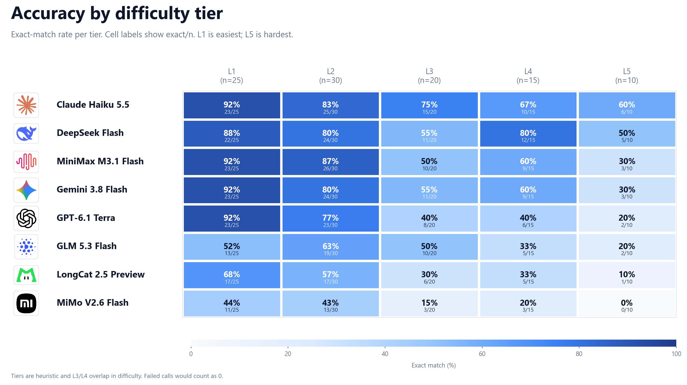
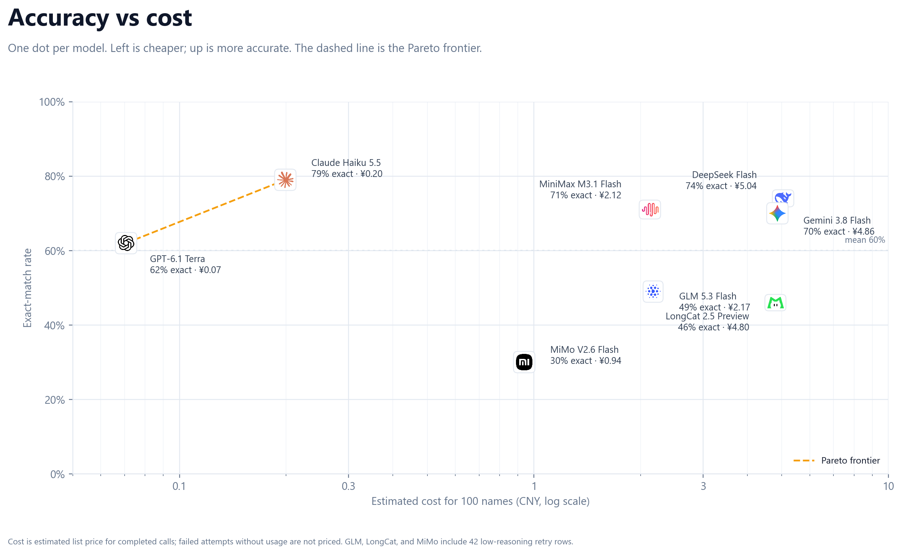
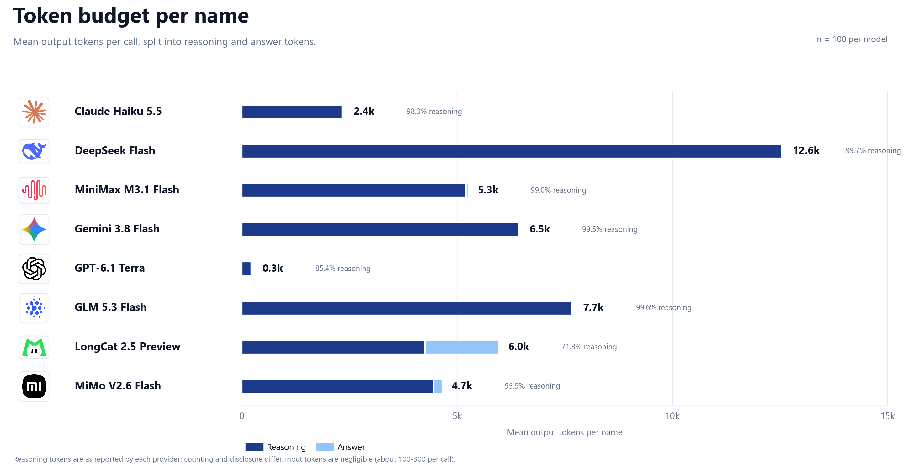

# Name2SMILES 百条评测

[English](eval_mini_100.md) | **简体中文**

八个模型回答同一百个 PubChem 名称，每个名称一次调用。800 次调用在重试后全部完成。Claude Haiku 5.5 的精确匹配率最高，为 79%。GPT-6.1 Terra 最便宜，每百条 0.07 元，按每个正确答案计算也最划算。准确率从最简单层的 78% 降到最难层的 28%。


## 结果

每个模型 100 条记录。`精确` 指规范异构 SMILES 完全一致；`连接性` 指去掉立体化学后一致；`有效` 指 RDKit 能解析答案；`Tanimoto` 是对有效答案计算的 Morgan 指纹平均相似度；`费用` 是按标价估算的 100 次完成调用成本。

| 模型 | 精确 | 连接性 | 有效 | InChIKey | Tanimoto | 每百条费用（元） | 每百个正确答案费用（元） | 平均输出 token | 平均延迟 |
|---|---:|---:|---:|---:|---:|---:|---:|---:|---:|
| Claude Haiku 5.5 | 79% | 84% | 100% | 83% | 0.95 | 0.20 | 0.25 | 2.4k | 15.8s |
| DeepSeek Flash | 74% | 80% | 100% | 85% | 0.93 | 5.04 | 6.82 | 12.6k | 71.8s |
| MiniMax M3.1 Flash | 71% | 74% | 98% | 80% | 0.91 | 2.12 | 2.99 | 5.3k | 51.4s |
| Gemini 3.8 Flash | 70% | 81% | 94% | 72% | 0.97 | 4.86 | 6.94 | 6.5k | 174.1s |
| GPT-6.1 Terra | 62% | 70% | 93% | 71% | 0.92 | 0.07 | 0.11 | 0.3k | 7.6s |
| GLM 5.3 Flash | 49% | 54% | 91% | 54% | 0.86 | 2.17 | 4.42 | 7.7k | 128.6s |
| LongCat 2.5 Preview | 46% | 52% | 88% | 53% | 0.81 | 4.80 | 10.43 | 6.0k | 61.5s |
| MiMo V2.6 Flash | 30% | 32% | 74% | 31% | 0.75 | 0.94 | 3.13 | 4.7k | 122.3s |

Tanimoto 只对有效答案取平均。如果把无效答案按 0 分计算，MiMo 会从 0.75 降到 0.55，其余模型下降不超过 0.09。

### 主要发现

- **Claude Haiku 5.5** 的精确匹配率最高（79%），连接性也最高（84%），所有答案都能被 RDKit 解析。每百条费用 0.20 元，平均每次调用 16 秒。
- **GPT-6.1 Terra** 每百条只要 0.07 元，每 100 个正确答案 0.11 元，是本次评测中成本最低的模型。它的精确匹配率为 62%。
- **DeepSeek Flash** 的精确匹配率排第二（74%），但每百条费用 5.04 元。它每条平均输出 1.26 万 token，其中 99.7% 是推理。相比 GPT-6.1 Terra，每百条多对 12 个，费用约为其 70 倍。
- **Gemini 3.8 Flash** 的立体化学差距最大：精确 70%，连接性 81%。它的有效答案 Tanimoto 为 0.97，是本次最高。平均每次调用 174 秒，也是最慢的。
- **GLM 5.3 Flash**、**LongCat 2.5 Preview**、**MiMo V2.6 Flash** 的精确匹配率分别为 49%、46%、30%。MiMo 还有 26% 的答案不能被 RDKit 解析。

800 次调用中，481 次精确匹配（60.1%），527 次去掉立体化学后匹配（65.9%），738 次是有效 SMILES（92.3%）。800 次 API 调用都返回了响应，无效答案指解析失败，不是缺失记录。

## 分层结果



百条集按启发式难度分为五层：L1 25 条，L2 30 条，L3 20 条，L4 15 条，L5 10 条。八个模型合计，精确匹配率为 L1 77.5%、L2 71.3%、L3 46.3%、L4 49.2%、L5 27.5%。L3 和 L4 的难度有重叠，L4 对部分模型反而更容易。分层用于覆盖采样，不是严格排名。

## 成本与 token



整轮 800 次完成调用按标价估算约 20.20 元。DeepSeek 使用谷时价格：输入每百万 token 1.00 元，输出 4.00 元，缓存命中 0.02 元。GPT-6.1 Terra 每百条 0.07 元，DeepSeek Flash 每百条 5.04 元。按每 100 个正确答案计算，GPT-6.1 Terra 为 0.11 元，Claude Haiku 5.5 为 0.25 元，其余模型为 2.99 到 10.43 元。



推理 token 是成本差距的主要原因。DeepSeek 每条平均输出 1.26 万 token；Gemini 6.5 千；GLM 7.7 千；LongCat 6.0 千；MiniMax 5.3 千；MiMo 4.7 千；Claude 2.4 千；GPT-6.1 Terra 0.3 千。平均输入为每次 107 到 297 token。不同厂商对推理 token 的统计方式不同，跨模型比较是近似值。

## 方法

- **数据：** 从 1500 条版本 0 数据中选出 100 条，文件为 `data/mini_100.jsonl`。百条集覆盖版本 0 的全部 53 种官能团，并分为五个难度层。
- **提示词：** 一条系统消息要求模型只返回一个有效 SMILES，不解释，不使用 Markdown；一条用户消息给出化合物名称。每条记录一次回答。
- **评分：** 使用 RDKit 2025.09.1。`精确` 为规范异构 SMILES 完全一致；`连接性` 去掉立体化学后比较；`有效` 表示 RDKit 能解析；`InChIKey` 为标准 InChIKey 完全一致；`Tanimoto` 为 Morgan 指纹相似度。
- **运行：** 每个模型 5 个 worker，共 40 个并发。初始读取超时 2400 秒，最大输出 100,000 token，推理强度 `high`。HTTP 429 和 503 会按指数延迟重新入队，最多 5 次。
- **重试：** 171 次尝试失败或超时。主批次和两次重试后，GLM、LongCat、MiMo 仍有 42 行失败。这 42 行改用 `low` 推理、25,000 最大输出、1200 秒超时后完成，其中 GLM 11 行、LongCat 18 行、MiMo 13 行。其余 758 行使用 `high`。
- **费用：** 使用 `config/llm_pricing.json` 的标价，DeepSeek 取谷时价格。没有返回用量的失败尝试不计费。总额是估算，不是服务商账单。
- **注意事项：** 这 42 行是三个模型里最难的情况，最终分数混合了两种推理强度。它们与另外五个模型的比较不是严格控制变量。

## 运行记录

批次于 2026 年 10 月 28 日 23:18（北京时间）启动。第一轮使用 2400 秒读取超时和 `high` 推理。一个后台 watcher 在主批次结束后重试失败行一次。第二轮把 GLM、LongCat、MiMo 的超时提高到 3600 秒。最后仍有 42 行失败，于是改用 `low` 推理、25,000 最大输出和 1200 秒超时重跑。最终文件包含 800 行，没有失败调用。

## 复现

```powershell
python -m pytest tests/
python scripts/make_mini_report.py
```

批量评测入口：

```powershell
python scripts/eval_mini_batch.py --data data/mini_100.jsonl `
  --timeout-seconds 2400 --workers-per-model 5
```

原始材料在 `data/eval_mini_100_20261028T231806/`：

- `dedup.jsonl`：800 行，每个模型和名称保留最新一行。
- `raw.jsonl`：971 行，包含失败尝试和重新入队的记录。
- `logs/`：主批次和重试日志。
- `summary.json`：绘图使用的重新汇总结果。

`data/` 已被 Git 忽略。图片在 `docs/figures/eval_mini_100/`，模型图标源文件在 `assets/icons/`，渲染后的 PNG 在图片目录下。

## 商标

模型名称和图标归各自所有者所有，仅用于标识本次评测的系统，不代表背书。
